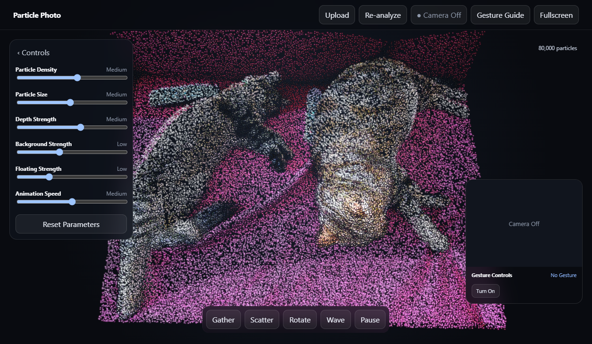

# Particle Photo

Particle Photo is an experimental Windows desktop app that turns a JPG or PNG
into an interactive, glowing 3D particle scene. Image analysis runs locally,
and the current experience focuses on four controls: **Gather**, **Auto
Rotate**, **Wave**, and **Burst**.



> [!NOTE]
> This project was created with substantial assistance from AI tools. It is a
> personal, just-for-fun experiment rather than a commercial product.

## Highlights

- Local photo-to-depth processing with Depth Anything V2 Small ONNX
- GPU-rendered glowing particles using Three.js and custom shaders
- Bounded Auto Rotate that gently tilts the scene instead of spinning 360°
- Offline-first processing: selected photos are not uploaded by the app
- English-only product interface
- Windows installer and portable ZIP build targets

## Privacy

Particle Photo processes selected images locally. The application does not
include analytics, accounts, cloud upload, camera access, or gesture tracking.
Do not commit personal photos, credentials, `.env` files, signing keys, or local
machine identifiers to this repository.

## Requirements

- Windows 10 or 11
- Node.js 24 and npm for development
- A WebGL-capable GPU

## Development

```powershell
npm ci
npm run dev
```

Run the main quality gate:

```powershell
npm run check
```

Additional validation commands:

```powershell
npm run audit:ui
npm run audit:security
npm run verify:models
npm run test:acceptance:images
npm run package
npm run test:e2e
npm run test:stability
```

Create Windows distributables with:

```powershell
npm run make
```

## Project status

This is a prototype. The installer is not code-signed and Windows SmartScreen
may display a warning. See [Known Issues](docs/KNOWN_ISSUES.md) and the
[Acceptance Report](docs/ACCEPTANCE_REPORT.md) for current limitations and test
evidence.

## AI disclosure

Product planning, code generation, refactoring, documentation, and test design
were completed with substantial AI assistance. Human direction and review
defined the intended experience and accepted the final result.

## Third-party software and models

The application uses open-source libraries and a locally packaged depth model.
See [Third-Party Notices](THIRD_PARTY_NOTICES.md) for attribution and license
details.

## License

Copyright © 2026 Particle Photo contributors. All rights reserved. The source
is publicly viewable, but no permission to copy, modify, or redistribute it is
granted unless a separate license is added later.
